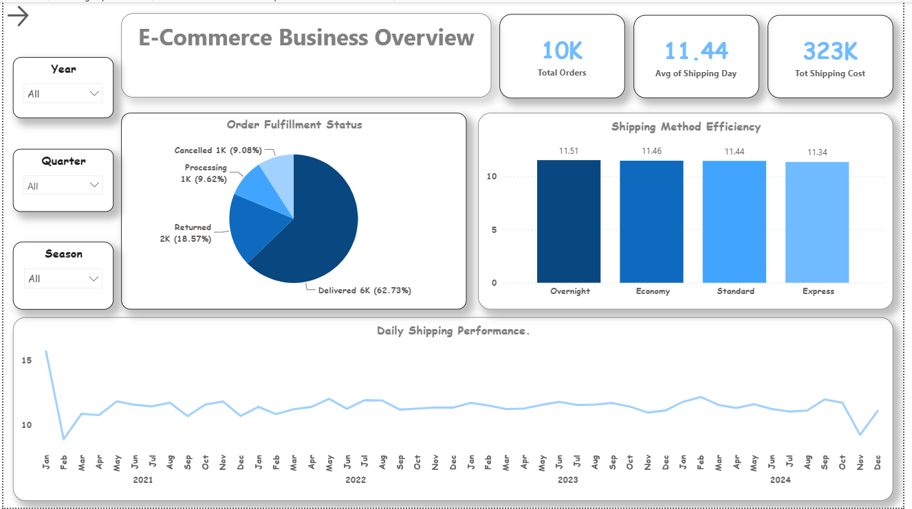
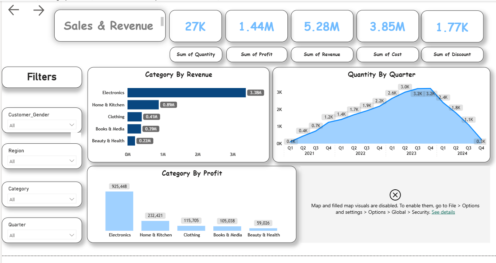
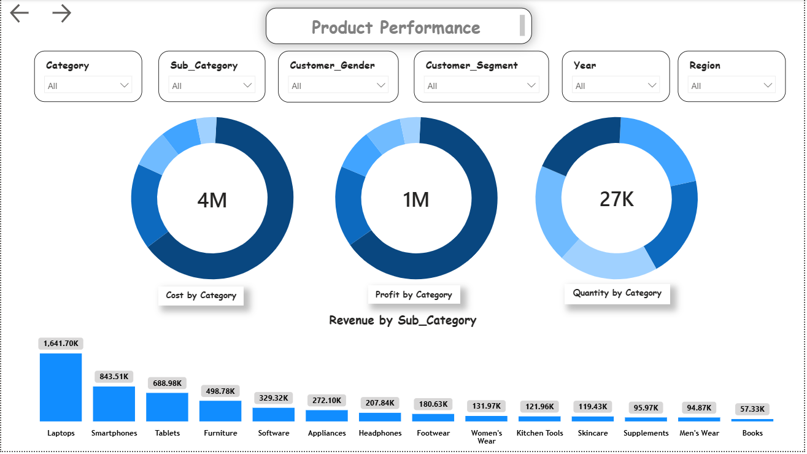
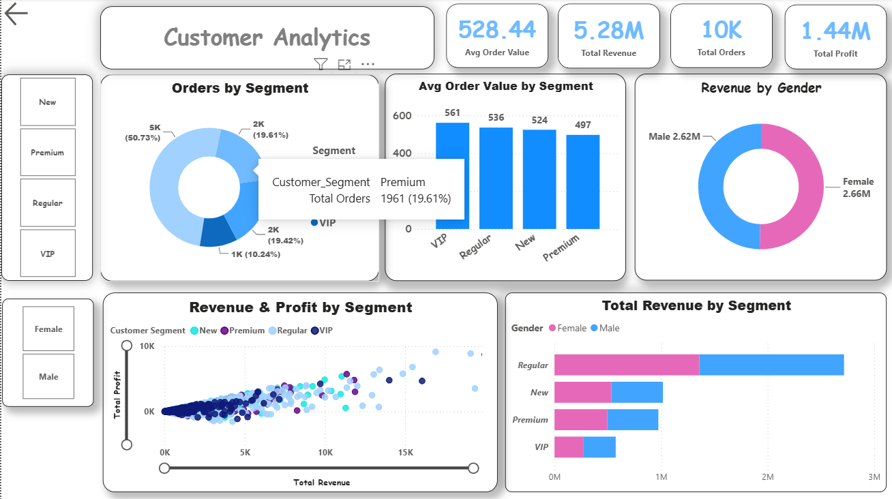

# E-Commerce Business Analytics Dashboard | Power BI

## Project Overview
An interactive E-Commerce Business Analytics Dashboard built using Microsoft Power BI to explore sales, revenue, profitability, product performance, customer behavior, and shipping operations.

This project is a customized version of an existing Power BI dashboard, with updated page titles and navigation verification.

## Dashboard Pages

1. **Business Overview** — Order fulfillment, shipping costs, shipping methods, and delivery performance.
2. **Sales & Revenue Analytics** — Sales performance and revenue insights.
3. **Product Analytics** — Product-level performance analysis.
4. **Customer Analytics** — Customer segments, average order value, and revenue analysis.

## Key Features

- Interactive Power BI dashboard
- Sales and profitability analysis
- Customer segmentation
- Product performance insights
- Shipping and order fulfillment analysis
- Year, quarter, and season filtering
- Dashboard page navigation

## Tools & Technologies

- Microsoft Power BI Desktop
- Power Query
- DAX
- CSV Dataset
- Data Visualization

## Dashboard Preview

## How to Use

1. Download or clone this repository.
2. Open `Ecommerce_Report.pbix` in Power BI Desktop.
3. If necessary, update the CSV data source path.
4. Refresh the data and explore the dashboard.

## Project Purpose

To explore E-commerce business performance through interactive reporting and demonstrate Power BI dashboard customization, data visualization, and analytical interpretation.
